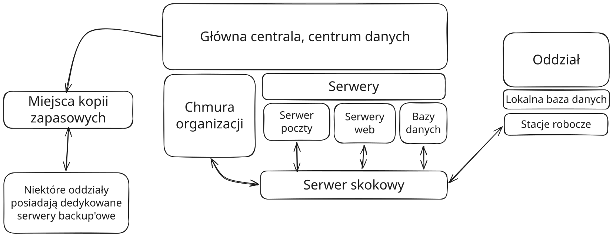
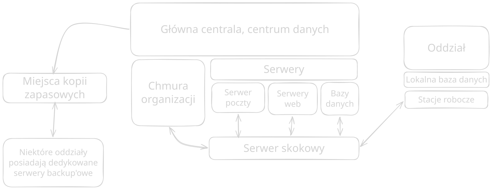

# Koncepcja SOC

Ten dział opisuje koncepcje SOC naszej organizacji.
Główne elementy tej części dokumentacji to:

* ramowa analiza ryzyka,
* warstwa organizacji SOC,
* warstwa ludzka SOC,
* oraz warstwa technologiczna SOC.

## Ramowa analiza ryzyka
Ramowa analiza ryzyka organizacji wynika z infrastruktury oraz systemów posiadanych przez organizację. Określenie tych komponentów pozwala na zidentyfikowanie potencjalnych zagrożeń i słabych punktów organizacji oraz na określenie przykładowych sposobów radzenia sobie z danymi zagrożeniami.

### Infrastruktura oraz systemy posiadane przez organizację {#sec-infrastruktura}
#### Schemat hierarchii organizacji

```{=html}
<table class="custom-grid-table">
  <!-- Wiersz 1 -->
  <tr>
    <th colspan="6" class="layer-coral">ZARZĄD - główna centrala Poznań</th>
  </tr>
  
  <!-- Wiersz 2 -->
  <tr>
    <td colspan="4" class="layer-banana">Działy</td>
    <td colspan="2" class="layer-mint">Oddziały poszczególnych miast (x18)</td>
  </tr>
  
  <!-- Wiersz 3 -->
  <tr>
    <td class="layer-plum">Dział HR</td>
    <td class="layer-plum">Dział marketingu</td>
    <td class="layer-apricot" style="border-radius: 20px 20px 0 0; border-bottom: none; padding-bottom: 6px;">Dział IT</td>
    <td class="layer-apricot" style="border-radius: 20px 20px 0 0; border-bottom: none; padding-bottom: 6px;">Dział Bezpieczeństwa</td>
    <td colspan="2" class="layer-mint-lighter">Kierownictwo</td>
  </tr>
  
  <!-- Wiersz 4 -->
  <tr>
    <td class="layer-plum">Dział konserwacji</td>
    <td class="layer-plum">Dział prawny</td>
    <td colspan="2" class="layer-apricot" style="border-radius: 0 0 20px 20px; border-top: none; padding-top: 6px;">Centrum Operacji Bezpieczeństwa (SOC)</td>
    <td colspan="2" class="layer-mint-lighter">Pododdział księgowości</td>
    
  </tr>
  
  <!-- Wiersz 5 -->
  <tr>
    <td colspan="2" class="layer-plum">Dział księgowości</td>
    <td colspan="2"></td> <!-- Puste miejsce pod spodem dla zachowania kolumn -->
    <td colspan="2" class="layer-mint-lighter">Pracownicy</td>
  </tr>
</table>
```
Powyższy schemat przedstawia hierarchię organizacji. Pod zarząd podlegają wszystkie działy.  **Centrum Operacji Bezpieczeństwa (SOC)** jest tworzony poprzez skuteczną współpracę **działu bezpieczeństwa** oraz **działu IT**. Oddziały poszczególnych miast również podlegają zarządowi. Kierownictwo księgowi oraz pracownicy oddziałów odpowiednio należą i odpowiadają przed konkretnymi działami istnejącymi w organizacji (Działy: HR, marketingu, konserwacji, prawny oraz księgowości).

#### Systemy posiadane przez organizację oraz zasoby udostępniane oddziałom

```{=html}
<div class="quarto-figure quarto-figure-center">
  <figure class="figure">
    <!-- Obrazek widoczny w trybie jasnym -->
    
    
    <!-- Obrazek widoczny w trybie ciemnym -->
    
    
    <figcaption class="figure-caption">Rysunek: Zasoby organizacji</figcaption>
  </figure>
</div>
```

Główna centrala posiada dedykowane serwery oraz chmurę dla pracowników. Istnieją też specjalne punkty kopii zapasowych, zlokalizowane w innych miejscach - wykonujące cykliczne backup'y centra danych.

* Chmura organizacji pozwala pracownikom na wymienianie się dokumetami biurowymi oraz przechowywanie ich. 
* Wewnętrzy serwer poczty pozwala na bezpieczną wymiane informacji w firmie
* Serwery Web służą do obsługi forum oraz dedykowanych narzędzi do obsługi partnerów 
  * W strefie zdemilitaryzowanej istnieje dodatkowy serwer Web, ktory udostępnia cykliczne informacje dla inwestorów
  * Jest też witryna internetowa dostępna publicznie, która posiada podstawowe informacje o organizacji oraz umożliwia na rejestracje wizity serwisowych.
* Bazy danych przechowują informacje o naprawianych wcześniej komputerach.
  * Serwisanci korzystają z bazy danych, aby patrzeć na potencjalne rozwiązania problemów, które już wcześniej mogły wystąpić.
  * Serwisanci dodają również w bazie danych nowe wpisy dotyczące serwisowania sprzętu
* W centrum danych jest zlokalizowany system ERP/CRM

Niektóre działy organizacji działają hybrydowo, lecz większość w znacznej mierze korzystaa z zasobów chmurowych.<br><br>
Przez duże rozproszenie firmy działy takie jak: dział HR, dział prawny i dział marketingu w znacznej mierze wymagają wsparcia systemów IT dla poprawnego działania.<br><br>
Pracownicy serwisujący sprzęt komputerowy nie potrzebują wsparcia IT dla poprawnego działania. System IT natomiast znacznie przyspiesza ich pracę i pomaga im w skutecznym serwisowaniu sprzętu.<br><br>

Wsród kluczowych zasobów organizacji, wyróżnić można bazy danych, które przechowują dane naszych klientów indywidualnych i biznesowych.<br><br>

Awaria lub przerwa w działaniu systemów organizacji, może spowodować paraliż pracy większości działów oraz znaczne wydłużenie pracy naszych pracowników <br><br>

Głównym źródłem zagrożeń są komputery zainfekowane, które mogą zainfekować naszą sieć i przedostać się na nasze serwery. <br><br>

Słabym punktem mogą być niewykwalifikowani ludzie z różnych działów, którzy przez błąd systemu lub awarie mogą mieć przywileje większe niż powinni. Taka podatność, wykorzystana w odpowiedni sposób może doprowadzić do wycieku danych <br>


### Znaczenie posiadanych systemów i zasobów dla organizacji

### Analiza zagrożeń

#### wybrane źródła zagrożeń

#### Wybrane techniki ataku

#### Wybrane, potencjalne, słabe punkty

#### Poziomy akceptowalnego ryzyka

#### Rejestr ryzyka

```{=html}
<div class="risk-dashboard">
  <div class="risk-list">
    <h3>Rejestr ryzyk <br><span style="font-size: 0.75rem">(Proszę kliknąć w element na liście)<span></h3>
    <div id="risk-list"></div>
  </div>

  <div class="risk-panel">
    <h3>Tabela ryzyka</h3>
    <div id="selected-info">Wybierz ryzyko z listy.</div>
    <div id="risk-matrix"></div>
    <div class="risk-legend">
      <span class="low">Niskie ryzyko</span>
      <span class="medium">Średnie ryzyko</span>
      <span class="high">Wysokie ryzyko</span>
      <span class="critical">Krytyczne ryzyko</span>
    </div>
  </div>
</div>

<script src="tools/riskRegister.js"></script>
```


## Warstwa organizacji


## Warstwa ludzka


## Warstwa technologiczna